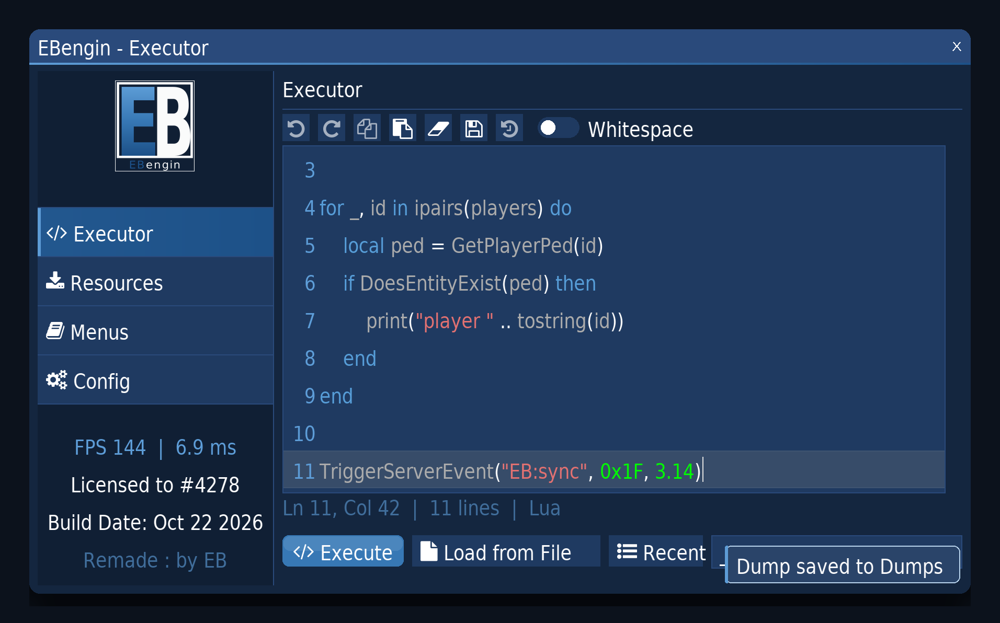
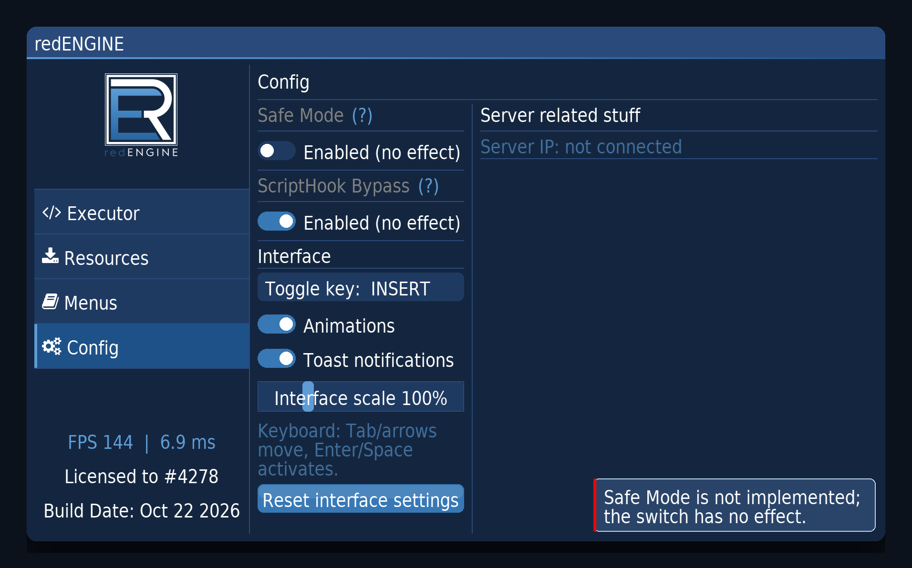
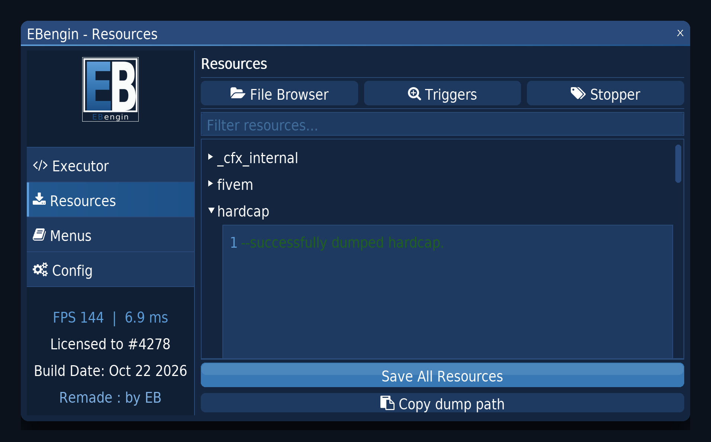
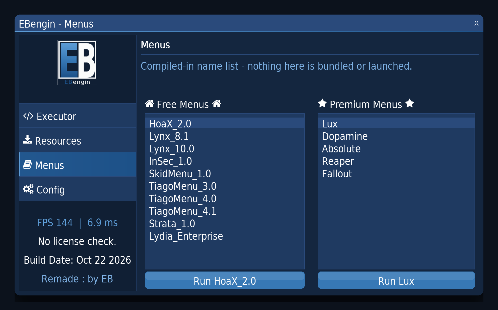
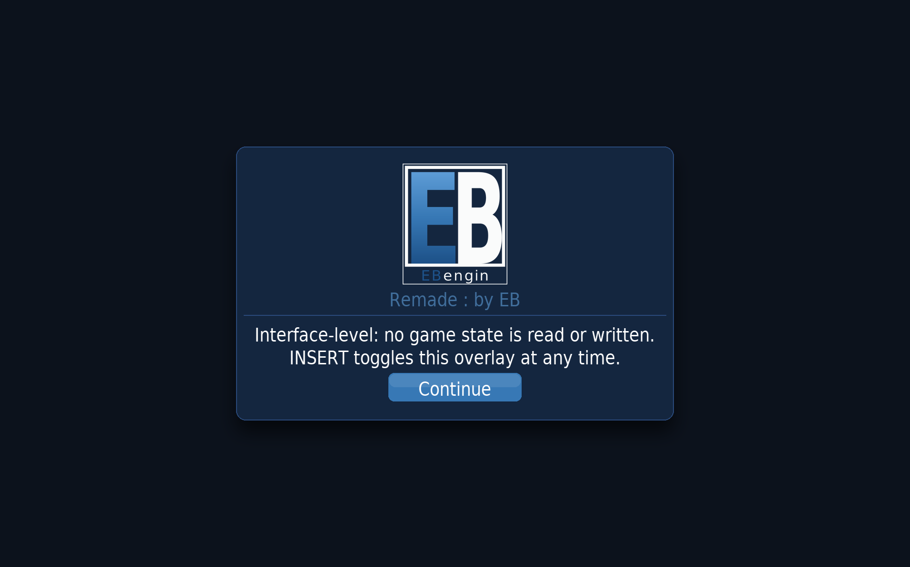
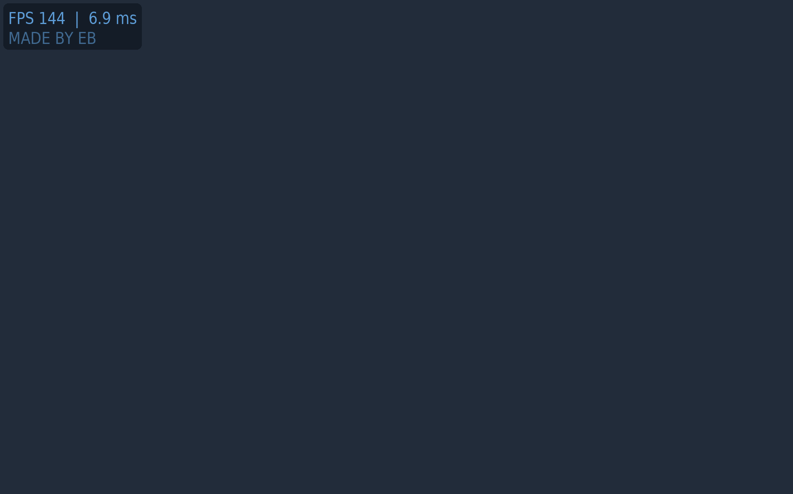
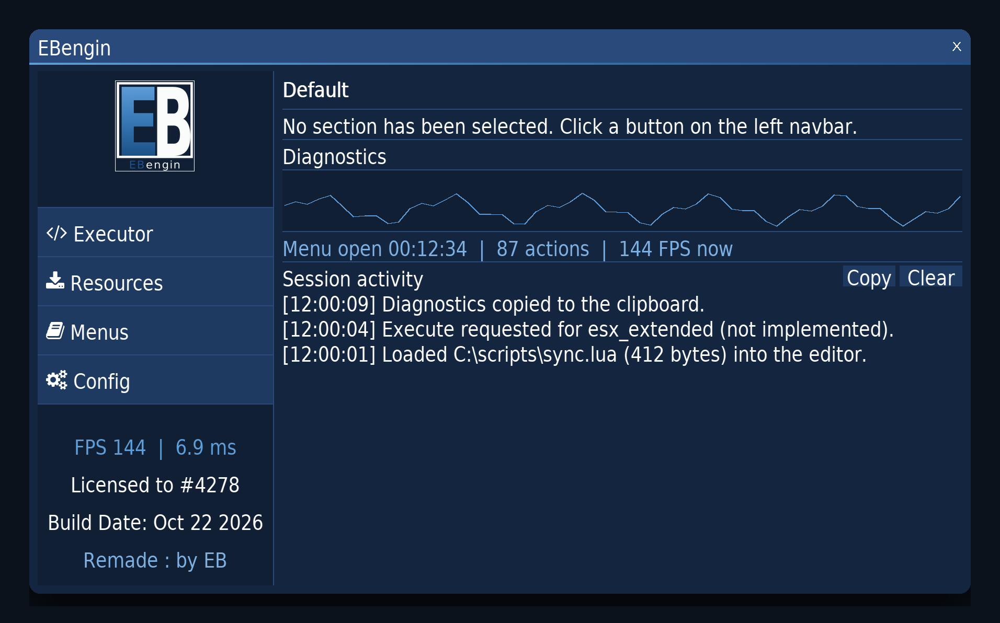
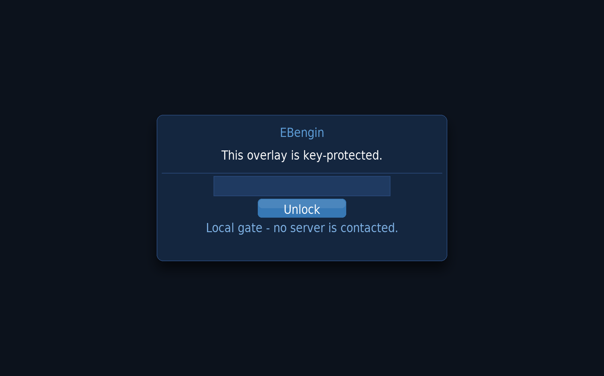

# EB-Fivem — EBengin UI

An in-game **Dear ImGui overlay for FiveM**, delivered as a Windows x64 DLL.

`main.cpp` hooks `IDXGISwapChain::Present` (vtable index 8) with [Kiero](kiero/kiero.h) +
MinHook, subclasses the window procedure, initialises ImGui with the DX11/Win32 backends and
draws the **EBengin** menu on top of the game. Press the toggle key (**INSERT** by default,
rebindable in Config → Interface) to toggle it.

Everything is vendored in-tree — no submodules, no package manager, no external downloads.



> **This is a render, not a screenshot.** The DLL cannot be executed on the machine that produced
> this branch (no MSVC, no Windows), so the image is drawn from the repository's own constants
> instead of being captured from a running game: every colour from [`menu_style.h`](menu_style.h),
> the 225 px sidebar and 46 px buttons from [`menu.h`](menu.h), the window title, logo placement,
> tab labels and footer strings from [`menu.cpp`](menu.cpp), the editor palette, the AA muted token #7DAFE1 (row 147) and Lua token
> colours from [`TextEditor.cpp`](TextEditor.cpp), and the sidebar/button glyphs from the project's
> **own embedded Font Awesome font** (the stb-compressed blob in `font_awesome.cpp`, decompressed for
> this render). Two things are substituted and cannot be faithful: the text face — `Bahnschrift.ttf`
> is a Windows-only font, so a horizontally condensed DejaVu Sans stands in for its DIN proportions —
> and ImGui's exact layout engine, which is not running here. The Lua snippet in the editor is
> illustrative; on first launch the menu opens on the empty landing tab. The landing render's
> sparkline and log entries are illustrative runtime data in the same sense - what the
> renderer guarantees is their layout (panel height, button row, line widths), not values.



> The same render with the **Config tab** open (`python docs/render_preview.py --config`):
> the Interface preferences - toggle-key capture, animations, toasts, FPS HUD with plate corner, the persisted
> 70-200 % scale slider, reset - and the two inert switches: greyed headings,
> `Enabled (no effect)` in the switch itself, an inert tooltip, and the warn toast that
> answers every flip. The right pane's About block names brand, credit, build
> configuration and host scale, flags a non-writable settings file in red, and its
> `Copy diagnostics` button puts exactly that line on the clipboard, and a second button
> opens the settings folder in Explorer with the file highlighted. The landing
> tab's session log - the timestamped trace of failures and refusals - is copyable
> the same way. The asserts in the renderer are what keep this pane's labels
> inside its ~216 px column.



> Third render (`python docs/render_preview.py --resources`), File Browser sub-tab:
> the filter field, the resource list with one header open and its read-only dump
> preview, and — since the fix in BUILD.md row 86 — the complete dump button
> block including "Copy dump path" inside the visible area. Every entry is the
> repository's own resource list from `exec.cpp`; the Triggers sub-tab is
> deliberately never depicted in preview imagery.



> Fourth render (`python docs/render_preview.py --menus`): the two menu lists
> with their selected rows visible — BUILD.md row 88 fixed a highlight that
> used to be the exact colour of the list background — and the honest "Run"
> stubs. The names are the repository's own lists; launching them remains
> unimplemented and says so.

First open after inject shows a branded start card instead of the shell - logo,
name and the credit line, dismissed with Continue.  Fifth render
(`python docs/render_preview.py --splash`):



While the overlay is closed, the frame-rate line lives on as a small HUD plate over
the scene, with the `MADE BY EB` credit as its second line (Config -> `FPS HUD`, on by default, persisted as `[ui] hud`; the plate corner is `Corner`, persisted as `[ui] hudcorner`).  Sixth render
(`python docs/render_preview.py --hud`), on a mid-tone scene stand-in:



The landing tab - diagnostics sparkline, uptime line and the session activity
log with its Copy/Clear pair - is the seventh render
(`python docs/render_preview.py --default`):



The session key gate in front of splash and shell (row 155: key `eb`, local
plaintext compare, unlocked once per inject) is the eighth render
(`python docs/render_preview.py --key`), depicted with its empty password
field:



## Layout

| Path | What it is |
|---|---|
| [`main.cpp`](main.cpp) | `DllMain`, Present hook, ImGui init/teardown, texture + font loading, input routing, hook trace log (`EBengin.log`) |
| [`includes.h`](includes.h) | Windows / D3D11 / DXGI / Kiero / ImGui includes, hook typedefs, `HK_CALL` |
| [`assets.h`](assets.h) | `ResolveAssetPath()` — finds files next to the DLL |
| [`menu.h`](menu.h) · [`menu.cpp`](menu.cpp) | Menu **shell**: the window, the 2-column `ImGui::Table`, the sidebar, `Menu::TabId` |
| [`tabs.h`](tabs.h) · [`tabs.cpp`](tabs.cpp) | **Tab routing**: the only place that knows which tabs exist |
| [`menu_style.h`](menu_style.h) | `ApplyStyle()` — colours, rounding, frame/cell padding (applied once) |
| [`gui.h`](gui.h) | Small helpers (`Gui::Seperator`, cursor setters, toggles, primary buttons) |
| [`settings.h`](settings.h) · [`settings.cpp`](settings.cpp) | Persisted interface prefs (`[ui]`, `[menu]`, `[window]`), host DPI scale, `ScaleFactor()`/`Px()`, save-failure flag, first-start notice |
| [`toasts.h`](toasts.h) · [`toasts.cpp`](toasts.cpp) | Non-blocking feedback stack: four-second lifetime, click dismisses, capped, drawn above the tab content |
| [`activity.h`](activity.h) · [`activity.cpp`](activity.cpp) | Timestamped in-memory session log (newest first, 32 kept, total counted) - the trace behind the landing tab |
| [`perf.h`](perf.h) · [`perf.cpp`](perf.cpp) | Frame-time ring and menu-open uptime (Sample() ticks only while the overlay renders - the landing card labels it "Menu open"): the sidebar FPS line and the landing sparkline |
| [`clipboard.h`](clipboard.h) | Header-only Win32 `CF_TEXT` writer shared by Config (diagnostics), the landing log and the Resources copy buttons |
| [`exec.h`](exec.h) · [`exec.cpp`](exec.cpp) | Executor tab — Lua editor with toolbar (undo/redo/copy/paste/clear/save/revert, whitespace toggle), status line (cursor, lines, last file, modified mark), honest Execute stub, Load/Save dialogs with confirmations and shortcuts, Recent-files popup (five last used paths from settings.ini), right-click menu, empty-state hint, resource combo |
| [`resources.h`](resources.h) · [`resources.cpp`](resources.cpp) | Resources tab — file browser, trigger list, resource stopper, dumps |
| [`config.h`](config.h) · [`config.cpp`](config.cpp) | Config tab — interface preferences (toggle key, animations, toasts, FPS HUD, scale, reset) plus the inert Safe Mode / ScriptHook Bypass placeholders - greyed headings, switches
labelled `Enabled (no effect)`, inert tooltips - and the About block: brand, credit, ImGui version, build configuration, host scale, not-writable warning, Copy diagnostics, Open settings folder |
| [`luamenus.h`](luamenus.h) · [`luamenus.cpp`](luamenus.cpp) | Menus tab — free / premium menu lists |
| [`demo.h`](demo.h) · [`demo.cpp`](demo.cpp) | Annotated ImGui widget cheat-sheet (not wired to a tab) |
| [`default.h`](default.h) · [`default.cpp`](default.cpp) | Landing tab - diagnostics card (sparkline, uptime, action count) and the session activity log with Copy/Clear |
| [`TextEditor.cpp`](TextEditor.cpp) · [`TextEditor.h`](TextEditor.h) | Vendored ImGui code editor widget |
| [`imgui/`](imgui) | Dear ImGui **1.93.0** + `imgui_impl_dx11` / `imgui_impl_win32` (vendored, unmodified). `imgui_demo.cpp` is on disk but not built — see [BUILD.md](BUILD.md) |
| [`kiero/`](kiero) | Kiero 1.2.6 (D3D11 enabled) + bundled MinHook 1.3.3 sources (vendored,
  unmodified, frozen by decision - see Notes) |
| [`ci/`](ci) | The GitHub Actions build workflow, staged as [`ci/build.yml`](ci/build.yml) + [`ci/enable.bat`](ci/enable.bat) — written and validated, **not yet enabled**. See [`ci/README.md`](ci/README.md) |
| [`font_awesome.h`](font_awesome.h) · [`font_awesome.cpp`](font_awesome.cpp) | Font Awesome icon macros + compressed TTF blob |
| [`stb_image.h`](stb_image.h) | PNG decoding for the menu logo (vendored **v2.30**) |
| [`EBengin.png`](EBengin.png) | Menu logo, loaded from beside the DLL at runtime |
| [`docs/preview.png`](docs/preview.png) | The preview render shown above, with its caption explaining exactly what is and is not faithful |
| [`docs/preview_config.png`](docs/preview_config.png) | The same render with the Config tab open, produced by `docs/render_preview.py --config` |
| [`docs/preview_resources.png`](docs/preview_resources.png) | The same render with the Resources tab open (`--resources`); the Triggers sub-tab is never depicted |
| [`docs/preview_menus.png`](docs/preview_menus.png) | The same render with the Menus tab open (`--menus`) |
| [`docs/preview_splash.png`](docs/preview_splash.png) | The first-open start card (`--splash`): logo, credit line, two honest hints, Continue |
| [`docs/preview_hud.png`](docs/preview_hud.png) | The FPS HUD plate over the scene while the overlay is closed (`--hud`) |
| [`docs/preview_default.png`](docs/preview_default.png) | The landing tab (`--default`): diagnostics sparkline, uptime line, session log with Copy/Clear |
| [`CHANGELOG.md`](CHANGELOG.md) | One entry per batch on this branch, newest first - the condensed view of the fix table in BUILD.md |

## Architecture

Two views of the same code: what happens at runtime, and what depends on what at compile time.
Both are kept in sync with the source by hand — if you change the hook, the frame loop or an
`#include`, change these too.

### Lifecycle and frame loop

From injection to the first rendered frame, and what happens on resize, device loss and unload.

```mermaid
flowchart TD
    A(["Injector loads EBengin UI.dll"]) --> B["DllMain: DLL_PROCESS_ATTACH"]
    B --> B1["g_hModule = hMod<br/>DisableThreadLibraryCalls"]
    B1 --> C["CreateThread → MainThread"]

    C --> D{"kiero::init D3D11<br/>== Success?"}
    D -- "no: UnknownError" --> D1["Sleep 500 ms"] --> D2{"120 attempts<br/>or unloading?"}
    D2 -- "keep retrying" --> D
    D2 -- "give up" --> D3(["trace line to EBengin.log,<br/>thread exits FALSE"])
    D -- "no: NotSupported /<br/>ModuleNotFound" --> D3
    D -- "yes" --> E{"kiero::bind index 8<br/>IDXGISwapChain::Present"}
    E -- "failed" --> E1["kiero::shutdown"] --> D3
    E -- "ok" --> F(["hook live, oPresent saved,<br/>attach line in EBengin.log"])

    F --> G["hkPresent runs every frame"]
    G --> H{"g_unloading or<br/>pSwapChain == NULL?"}
    H -- "yes" --> Z["return oPresent"]
    H -- "no" --> I{"init?"}

    I -- "first frame" --> J["GetDevice, GetImmediateContext<br/>GetDesc → window<br/>CreateRenderTarget"]
    J --> K{"all succeeded?"}
    K -- "no" --> Z
    K -- "yes" --> L["subclass WndProc<br/>only when oWndProc == NULL"]
    L --> M["InitImGui: fonts, EBengin.png beside the DLL,<br/>ApplyStyle once, host DPI, Settings::Load, ApplyScale,<br/>Executor::Init, Resources::Init"]
    M --> N["init = true"]

    I -- "later frames" --> O{"back buffer size<br/>changed?"}
    O -- "yes" --> P["CleanupRenderTarget<br/>InvalidateDeviceObjects<br/>CreateRenderTarget<br/>CreateDeviceObjects"]
    O -- "no" --> Q
    P --> Q
    N --> Q

    Q["re-sample host DPI per frame, ApplyScale on change<br/>NewFrame for DX11, Win32 and ImGui<br/>MouseDrawCursor = Menu::IsMenuOpen"] --> R{"Toggle key pressed?<br/>edge triggered, suppressed while a<br/>capture is armed or a text field<br/>consumes a printable binding"}
    R -- "yes" --> S["toggle Menu::IsMenuOpen"] --> T
    R -- "no" --> T{"IsMenuOpen?"}
    T -- "yes" --> U["Menu::Render<br/>first open: splash card, first-start<br/>notice if no settings.ini, then shell:<br/>sidebar column + Tabs::Render"] --> V
    T -- "no" --> UH{"FPS HUD on?<br/>[ui] hud = 1"}
    UH -- "yes" --> UHR["Menu::RenderHud<br/>FPS plate on the background list"] --> V
    UH -- "no" --> V

    V["ImGui::Render<br/>OMSetRenderTargets<br/>RenderDrawData"] --> W["hr = oPresent"]
    W --> X{"DEVICE_REMOVED<br/>or DEVICE_RESET?"}
    X -- "yes" --> Y["CleanupImGui, release device<br/>and context → re-init next frame"] --> Z2(["return hr"])
    X -- "no" --> Z2

    G -.-> WP
    subgraph WP["WndProc, on every Windows message"]
        direction TB
        W1["ImGui_ImplWin32_WndProcHandler<br/>feeds ImGui"] --> W2{"over an ImGui window<br/>or a widget wants text?"}
        W2 -- "yes" --> W3(["return 0, the game never sees it"])
        W2 -- "no" --> W4(["CallWindowProc → game"])
    end

    UN(["DLL_PROCESS_DETACH"]) --> U1["g_unloading = true, Sleep 50 ms,<br/>Settings::Save flush"] --> U2["CleanupImGui: backends, context,<br/>render target, logo, restore WndProc"] --> U3["kiero::shutdown"] --> U4["session-ended line<br/>in EBengin.log"]
```



The two details that are easy to get wrong in a Present hook, and are therefore explicit in the
code: the window is subclassed **only** when `oWndProc == NULL` (a second `SetWindowLongPtr` would
store our own `WndProc` as the "original" and build an endless call chain), and `g_unloading` is
latched *before* anything is torn down so the game cannot be inside `hkPresent` while the ImGui
context disappears under it.

### Include graph

Rectangles are translation units, rounded boxes are headers, each subgraph is one `.cpp` plus the
header it owns. **Generated from the actual `#include` lines** — 35 nodes, 77 edges (regenerate with `python docs/gen_include_graph.py`).

```mermaid
flowchart LR
    subgraph sg_TextEditor["TextEditor"]
        n0["TextEditor.cpp"]
        n1(["TextEditor.h"])
    end
    subgraph sg_activity["activity"]
        n2["activity.cpp"]
        n3(["activity.h"])
    end
    subgraph sg_config["config"]
        n4["config.cpp"]
        n5(["config.h"])
    end
    subgraph sg_default["default"]
        n6["default.cpp"]
        n7(["default.h"])
    end
    subgraph sg_demo["demo"]
        n8["demo.cpp"]
        n9(["demo.h"])
    end
    subgraph sg_exec["exec"]
        n10["exec.cpp"]
        n11(["exec.h"])
    end
    subgraph sg_font_awesome["font_awesome"]
        n12["font_awesome.cpp"]
        n13(["font_awesome.h"])
    end
    subgraph sg_luamenus["luamenus"]
        n14["luamenus.cpp"]
        n15(["luamenus.h"])
    end
    subgraph sg_main["main"]
        n16["main.cpp"]
    end
    subgraph sg_menu["menu"]
        n17["menu.cpp"]
        n18(["menu.h"])
    end
    subgraph sg_perf["perf"]
        n19["perf.cpp"]
        n20(["perf.h"])
    end
    subgraph sg_resources["resources"]
        n21["resources.cpp"]
        n22(["resources.h"])
    end
    subgraph sg_settings["settings"]
        n23["settings.cpp"]
        n24(["settings.h"])
    end
    subgraph sg_tabs["tabs"]
        n25["tabs.cpp"]
        n26(["tabs.h"])
    end
    subgraph sg_toasts["toasts"]
        n27["toasts.cpp"]
        n28(["toasts.h"])
    end
    n29(["assets.h"])
    n30(["clipboard.h"])
    n31(["gui.h"])
    n32(["includes.h"])
    n33(["menu_style.h"])
    n34(["stb_image.h"])

    n0 --> n1
    n2 --> n3
    n4 --> n3
    n4 --> n5
    n4 --> n11
    n4 --> n24
    n4 --> n28
    n4 --> n30
    n4 --> n33
    n5 --> n13
    n5 --> n31
    n6 --> n3
    n6 --> n7
    n6 --> n20
    n6 --> n28
    n6 --> n30
    n6 --> n31
    n8 --> n9
    n10 --> n3
    n10 --> n11
    n10 --> n22
    n10 --> n28
    n10 --> n31
    n11 --> n1
    n11 --> n13
    n14 --> n3
    n14 --> n13
    n14 --> n15
    n14 --> n28
    n14 --> n31
    n16 --> n5
    n16 --> n11
    n16 --> n13
    n16 --> n18
    n16 --> n22
    n16 --> n24
    n16 --> n29
    n16 --> n32
    n16 --> n33
    n16 --> n34
    n17 --> n13
    n17 --> n18
    n17 --> n20
    n17 --> n24
    n17 --> n26
    n17 --> n28
    n17 --> n31
    n18 --> n24
    n19 --> n20
    n21 --> n3
    n21 --> n22
    n21 --> n24
    n21 --> n28
    n21 --> n29
    n21 --> n30
    n21 --> n33
    n22 --> n1
    n22 --> n11
    n22 --> n13
    n22 --> n31
    n23 --> n3
    n23 --> n5
    n23 --> n24
    n23 --> n28
    n23 --> n29
    n25 --> n5
    n25 --> n7
    n25 --> n11
    n25 --> n15
    n25 --> n18
    n25 --> n22
    n25 --> n26
    n27 --> n24
    n27 --> n28
    n31 --> n13
    n31 --> n24
    n31 --> n33
```



What the shape of that graph is meant to show:

* **`menu.cpp` has three edges** (`gui.h`, `menu.h`, `tabs.h`). The shell does not know which tabs
  exist; it calls `Tabs::Render()`.
* **`tabs.cpp` is the only node pointing at all five tabs.** Adding a tab touches `tabs.cpp`, one
  `SidebarItems[]` row in `menu.cpp` and one `Menu::TabId` enumerator — not the hook code.
* **`main.cpp` points at `exec.h` and `resources.h` but at no tab body.** It only calls
  `Executor::Init()` / `Resources::Init()`; the includes it needs are `includes.h`, `menu.h`,
  `menu_style.h` and `assets.h`.
* Only three headers include anything at all: `config.h → gui.h`, `exec.h → TextEditor.h` and
  `resources.h → {TextEditor.h, exec.h, gui.h}`. The other ten — `assets.h`, `default.h`, `demo.h`,
  `gui.h`, `includes.h`, `luamenus.h`, `menu.h`, `menu_style.h`, `tabs.h`, `TextEditor.h` — have no
  outgoing edges. Nothing defines state in a header any more, which is what used to make a second
  including `.cpp` a `LNK2005`.

Vendored code (`imgui/`, `kiero/`, `stb_image.h`, `font_awesome.*`) is left out for readability; it
has no edges into the project's own headers.

## Building

Full instructions, requirements and a troubleshooting table: **[BUILD.md](BUILD.md)**.

Quick version — Windows 10/11, Visual Studio 2019 or 2022 with the
*Desktop development with C++* workload (the legacy DirectX SDK is **not** required):

```bat
build.bat
```

or from a Developer Command Prompt:

```bat
msbuild "EBengin UI.sln" /t:Rebuild /p:Configuration=Release /p:Platform=x64 /m
```

Output: `x64\Release\EBengin UI.dll`. Put `EBengin.png` in the same folder as the DLL, otherwise
the sidebar falls back to a text logo.

Heads-up: the output is a **DLL**, so Visual Studio's F5 / "Start Debugging" cannot launch
it.  The tracked `.vcxproj.user` therefore points F5 at the output folder (Explorer, attach
off) - copies from before row 143 instead show the old "is not a valid Win32 application" /
"ist keine gültige Win32-Anwendung" dialog, which was never a build failure.  Build with
Ctrl+Shift+B or `build.bat`; to debug live, attach to the process that loads the DLL.
See BUILD.md §8.

A GitHub Actions workflow that does the same on `windows-latest` (Release and Debug, x64), verifies
the DLL and its export table exist, and uploads it as an artifact is written, validated and
**committed at [`ci/build.yml`](ci/build.yml) — but not yet enabled**. It cannot live in
`.github/workflows/` because creating files there needs the `workflows` permission, which the token
that produced this branch does not have; GitHub refuses the push outright. Moving it into place is
one commit from your account: run [`ci/enable.bat`](ci/enable.bat) (it copies and stages the file,
then stops so you keep the commit), or paste it in through the web UI. Full instructions in
[`ci/README.md`](ci/README.md) and [BUILD.md §7](BUILD.md).

Until then there is **no CI and no compile proof** — every check on this branch was static.

> Build **x64 only** — a Win32 DLL cannot be loaded by FiveM.

## Runtime behaviour

* The toggle key — **INSERT** by default, rebindable in Config → Interface — toggles the menu.
* The menu is keyboard-navigable: Tab/arrows move the focus, Enter/Space activates,
  Ctrl+Tab / Ctrl+Shift+Tab cycle the tabs, and the sidebar logo returns to the landing
  tab - both hand the keyboard cursor over to the new tab's sidebar entry
* A session key gate sits in front of splash and shell: once per inject the overlay
  asks for its key (password field, Enter submits); the check is local plaintext against a
  constant - no server, no persistence - and the card says so; a Caps-Lock
  hint line explains case-mismatched attempts while Caps Lock is on
  (ImGui keyboard nav, accent-coloured focus rectangle).
* Opening the menu gives it keyboard focus; the nav cursor starts on the sidebar entry of
  the open tab (first entry on the landing tab, which has no sidebar row).
* While the cursor is over the menu (or you are typing in the executor), mouse and keyboard
  messages are consumed instead of being passed to the game — clicking a button no longer also
  punches/shoots in-game, and typing Lua no longer walks the character around.
* Resolution changes, alt-tab and borderless↔fullscreen transitions rebuild the render target;
  a lost/reset D3D device tears the overlay down and re-initialises on the next frame.
* Dumps are written to `<DLL folder>\Dumps\` (`fxmanifest.lua` + `resources.txt`), which needs
  no elevation.

## Notes

* The vendored ImGui is **1.93.0** (upgraded from 1.75 via 1.92.9 — see the migration table in
  [BUILD.md](BUILD.md#6-imgui-175--1929-migration)). `imgui/` and `kiero/` hold unmodified
  upstream code; keep local changes in the project's own files so those trees can be re-synced
  cleanly. `kiero/` is additionally frozen at 1.2.6 by decision: upstream has been README-only
  since its last code commit in May 2022 (tag `1.2.12`), and the 1.2.6→1.2.12 delta is
  hook-layer code this project does not carry (BUILD.md, §9 "Vendored freeze and pin
  status").
  `TextEditor.*` and the Font Awesome blob are pinned for the same kind of reason: no
  meaningful upstream delta, and the successor editor is a rewrite, not a new version.
  Note that `imgui_tables.cpp` is a separate translation unit since 1.80 and must stay
  in the project.
* The code uses **no deprecated ImGui API**: the menu shell was moved off the legacy
  `Columns()`/`NextColumn()`/`SetColumnOffset()` API onto `BeginTable`/`TableSetupColumn`. That
  makes `#define IMGUI_DISABLE_OBSOLETE_FUNCTIONS` in `imgui/imconfig.h` a clean compile, and the
  recommended way to stay ahead of the next upgrade. (`demo.h` still uses `Columns()` — it is an
  annotated cheat-sheet wired to no tab, left alone on purpose.)
* `style.CellPadding` is `(0,0)` in `menu_style.h`. That is not cosmetic: table cells are inset by
  `CellPadding` on every side, so the default `4,1` would leave the 225px sidebar with 217px of
  usable width. Keep it at zero, or subtract the padding from `Menu::SidebarWidth`.
* What is **implemented**: the full UI, the Lua editor with syntax highlighting, Load-from-file,
  the trigger clipboard list, resource dumps, and the resource-list stopper (which
  confirms before removing an entry).
  What is **still a stub** (and now says so in a tooltip before the click as well as in a
  message box after it, instead of doing nothing silently):
  actually executing a script, actually stopping a server resource, launching the listed menus,
  and the Safe Mode / ScriptHook Bypass toggles — those two carry greyed headings and switches
  labelled `Enabled (no effect)` in the tab itself, with inert tooltips and a toast on every
  flip, because nothing reads them.
* `font_awesome.cpp` is `#include`d by `main.cpp` rather than compiled as its own translation
  unit; it is marked `ExcludedFromBuild` in the project so nobody adds it twice.
* Every menu global is declared `extern` in its header and defined in exactly one `.cpp`, so
  adding a second translation unit cannot produce `LNK2005` duplicates.
* **Shell and tabs are separate translation units.** `menu.cpp` draws the window and the sidebar and
  calls `Tabs::Render()`; `tabs.cpp` owns the `switch` and is the only file that includes the five tab
  headers. `main.cpp` (hooks, device, ImGui lifetime) includes neither. Adding a tab therefore touches
  `tabs.cpp`, `menu.cpp` (one `SidebarItems[]` row) and `menu.h` (one `TabId` enumerator) — not the
  hook code.
* `demo.h` is compiled but wired to no sidebar entry; call `Demo::Render()` from `Tabs::Render()` if
  you want the widget cheat-sheet on screen.
* **The theme is two ramps of three stops each**, all of them in [`menu_style.h`](menu_style.h): an
  interactive light ramp — `#5D9CD6` accent/rest, `#3778B5` hover, `#1D5188` pressed — and a navy
  surface ramp — `#2A4A7B` title bar and raised borders, `#1F3A61` panels, buttons and the editor
  background, `#14263F` the window canvas. `Menu::Accent`, the editor's line numbers and the logo
  fallback text share `#5D9CD6`. Semantic reds (editor error markers, the "no files" warning) stay
  red on purpose. `rE.png` was recoloured to the light ramp as a vertical gradient — white outline
  and alpha channel untouched — and [`docs/render_preview.py`](docs/render_preview.py) regenerates
  `docs/preview.png` (and, with `--config`, `docs/preview_config.png`) from exactly these
  constants.
* **Interface preferences persist** in `<DLL folder>\settings.ini`: window position, last open tab
  and the overlay toggle key (Config → "Toggle key", click-to-capture, ESC cancels). The sidebar
  footer carries a live FPS / frame-time readout, and the landing tab lists a timestamped session
  log of loads, dumps, copies and stop/run requests — the actions whose only other feedback is a
  message box. All of it is in `settings.cpp` / `activity.cpp`. Hook-level outcomes go to a
  second, separate file: `<DLL folder>\EBengin.log` keeps one timestamped line per inject —
  attach, the failure that stopped it, or the clean unload — capped at 64 KB (`main.cpp`).
* **The interface gives non-blocking feedback:** success/info paths (loads, dumps, copies,
  run/execute requests, key captures) raise a toast card in the window's bottom-right corner
  instead of a focus-stealing message box; critical errors keep theirs. The window opens with a
  short fade, the sidebar's tab marker slides to the selected entry, and primary actions
  (Execute, Save All Resources, Run) draw in the brand blue instead of the default navy.
  Config → Interface can switch animations and toasts off; both are persisted in `settings.ini`.
* **Tab comfort:** the editor carries a status line (Ln/Col, line count, language, the
  last loaded or saved file, and a `modified` mark while unsaved edits exist), the Resources
  file browser and stopper have case-insensitive filter boxes, and the landing tab's Diagnostics
  card draws a 120-frame frame-time sparkline with menu-open uptime and action count (`perf.cpp`).
* **Editor toolbar:** icon buttons for undo/redo/copy/paste/clear, save (one click to the
  last file, Shift+click or a first save through the dialog - which reopens on the last
  file's folder with its name prefilled - Ctrl+S from the keyboard, Ctrl+Shift+S forcing
  that dialog, Ctrl+O mirroring Load, and a Save onto a file that changed on disk since it
  was loaded asks before burying those edits) and
  revert-to-last-file sit above the executor (tooltips
  name the shortcuts); undo/redo/copy grey out via `BeginDisabled` whenever there is nothing to
  undo, redo or copy, paste while the clipboard holds no text and clear while the buffer
  is empty, each saying so in the tooltip. Load and Clear confirm before discarding
  a non-empty buffer (SetText wipes undo). The status line reports the selection size, the
  resource combo falls back to a muted line once the stopper erased the last entry, and toast
  cards dismiss on click without ever stealing a click from a widget under the stack, and
  an empty buffer names its three ways in - type, Ctrl+V, Ctrl+O - as muted placeholder
  text in the editor's own top-left corner.  A right-click in the editor opens a context
  menu mirroring undo/redo, cut/copy/paste and select-all with the same disabled rules.
* **Small persistences:** a first start without `settings.ini` says so in the log and a toast,
  the editor whitespace dots, the open Resources sub-tab and a
  "Reset interface settings" button that confirms before overwriting join window
  position, last tab, toggle key, the
  animation/toast switches and the interface scale in `settings.ini`.
* **Interface scale:** Config → Interface carries a 70–200% slider, persisted as `[ui] scale` and
  applied through ImGui 1.92's `style.FontScaleMain`, so fonts, frames, sidebar and window size
  grow together instead of text overflowing fixed widgets. Explicit widget sizes do not follow the
  font on their own, so every hardcoded pixel size in the tabs (button heights, the switch track,
  list boxes, toast cards, the logo) goes through `Settings::Px()` — the identity at 100 %,
  twice the compiled pixels at 200 %. It applies when the slider is released
  — 1.92 bakes a font for every distinct size it sees, so a live drag would bake ~130 of them.
  The shell is re-clamped on screen whenever the scale changes, so growing it to 200% cannot push
  the title bar off-screen and leave nothing to grab.
* **Environment compatibility:** the menu degrades honestly instead of breaking — a missing
  `Bahnschrift.ttf` falls back to ImGui's default font, a missing `EBengin.png` to the text logo, and the
  first failed `settings.ini` write (read-only DLL folder) answers with a warn toast instead of
  pretending the preference was saved. On per-monitor-DPI-aware hosts the layout follows the
  window's contents scale through `style.FontScaleDpi`; on 96-DPI hosts every factor is the
  identity. What this branch explicitly does *not* do: it has never run against a live FiveM or GTA
  client, and nothing here adapts the inject hook, the graphics-API path or any anti-cheat
  interaction to a game version.
* **Two honest details:** the Resources tab can copy the dump folder path to the clipboard (before,
  that path only ever appeared inside a message box), and switching toast notifications off now
  empties the stack instead of letting a half-faded card reappear when they are switched back on.

## Credits

Menu UI made by EB · ImGui by [Omar Cornut](https://github.com/ocornut/imgui) ·
Kiero by [Rebzzel](https://github.com/Rebzzel/kiero) · MinHook by Tsuda Kageyu ·
`stb_image` by Sean Barrett · ImGuiColorTextEdit by BalazsJako.
